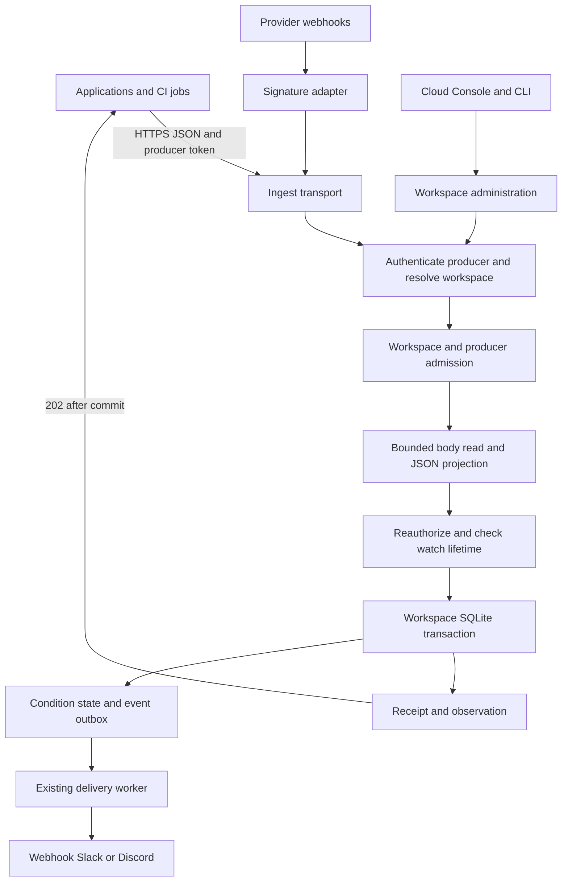

# Ding Cloud push ingestion implementation plan

Proposed October 12, 2026. **Implementation is on `codex/cloud-push`, based on current `main`; release qualification is in progress.** Railway now tracks `main`, but the push changes are not deployed until their PR lands.

See the [qualification record](cloud-push-qualification.md), [operator runbook](cloud-push-operations.md), and [user guide](../guides/push.md). Core service, credential management, strict projection, retries, admission, diagnostics, Console setup, migration, restart/disk tests, and an HTTPS load driver are implemented. Native adapters are implemented behind a disabled-by-default flag. The external Railway soak and real GitHub/Stripe qualification remain release gates; the design below is not a claim that those gates have passed.

Build a production JSON push service for multiple Ding Cloud users and workspaces. A producer sends authenticated JSON to a watch, receives a durable receipt, and can safely retry an uncertain request. Ding evaluates the observation, keeps relevant evidence, and delivers the configured alerts. Users can separate resources into individual watches or use grouping within a watch.

Use the existing Go runtime, workspace SQLite stores, evaluator, and delivery outbox. Extend the [Railway deployment plan](railway-cloud-plan.md) and [shared account foundation](shared-accounts-plan.md). This plan governs push behavior and its release tests; the Railway plan governs the host, account bootstrap, HTTPS, persistent volume, and deployment. A working owner demonstration is an intermediate milestone. Public availability requires the multi-workspace and operational gates below.

The previous three-watch, ten-entity, and five-minute product restrictions are not requirements for this work. Replace hardcoded product ceilings with validated operator configuration and measured capacity. Keep finite bounds on incoming bytes, concurrency, parsing, storage, and retries so one producer cannot exhaust the shared process. Rate and capacity settings describe the deployed service; they are not a pricing model.

All new endpoints, fields, commands, configuration names, and performance targets below are proposed until their milestone lands. Existing implementation claims refer to the source inspected on October 12, 2026.

## Intended user experience

1. An owner or administrator creates a workspace producer credential and selects the existing push watches it may write to. The secret is shown once, with expiry and rotation controls.
2. The watch page shows its HTTPS ingest URL, selected JSON fields, grouping fields, and a copyable request using a secret variable. A producer credential grants ingestion only unless another service permission is explicitly authorized.
3. A script, CI job, application, gateway, or configured HTTP integration posts JSON with that credential and an idempotency key. The producer can run on a private network as long as it can reach Ding over HTTPS.
4. The response identifies the accepted observation range and whether the request was a retry. The Console separately shows input acceptance, condition state, generated events, and notification delivery.
5. Two users in different workspaces can use identical watch names and request keys without sharing data. Two members of one workspace see the same watches according to their roles.
6. Eighteen repositories can use eighteen independently configured watches, or one watch grouped by repository and workflow. A failure in one group cannot open or recover an incident in another.

The generic endpoint accepts clients that can supply Ding authentication. Native GitHub and Stripe webhooks use provider signatures and require the adapters described later. The names of JSON fields never authenticate a producer.

## Existing implementation and concrete gaps

| Area | Existing source | Required change |
| --- | --- | --- |
| Local acceptance | [HTTP ingest handler](../../internal/control/server.go), [projection](../../internal/watchrun/ingest.go), and [transactional evaluation](../../internal/watchrun/app.go) | Reuse acceptance while supplying trusted cloud producer identity and stronger retry semantics |
| Hosted policy | [hostingpolicy](../../internal/hostingpolicy/policy.go) permits explicit public HTTP URLs and enforces small fixed limits | Admit push separately from HTTP acquisition and expose effective configured capacity |
| Hosted credentials | [cloud service routes](../../internal/cloud/services.go) explicitly reject cloud ingest grants and requests | Enable ingest with workspace and watch authorization; add rotation and stable producer identity |
| Service identity | [serverstate services](../../internal/serverstate/services.go) store a hashed token, watch ID list, expiry, and revocation | Separate logical producer from rotating keys; bind permission to the intended watch lifetime |
| Admission | [cloud server](../../internal/cloud/server.go) has global admission and a workspace limiter for ordinary sessions | Service requests return before that workspace limiter; apply producer and workspace admission to ingestion explicitly |
| Revocation | An access read lock spans ordinary authenticated requests | Keep slow body reads and projection outside the authorization fence; reauthorize at commit |
| Receipts | [receipt storage](../../internal/store/records.go) keys by watch, generation, and caller key; it stores sequence bounds | Add producer scope and request digest; retain cloud receipts across watch state resets |
| Reset behavior | [ResetState](../../internal/store/lifecycle.go) deletes input receipts when evaluation state resets | Separate cloud receipt retention from evaluator reset so an ordinary edit cannot reaccept a recent retry |
| Transport limits | The outer hosted handler caps ordinary bodies at 96 KiB; the watch also has a body limit | Use one effective ingest contract through edge, handler, parser, and watch |
| Metering | [cloud network accounting](../../internal/cloud/network.go) and [usage](../../internal/serverstate/usage.go) meter outbound checks and deliveries | Measure inbound attempts separately; commit accepted usage with the observation receipt |
| Persistence upgrades | [watch store](../../internal/store/store.go) has migrations; [server metadata](../../internal/serverstate/state.go) accepts only its current schema | Add transactional server metadata migrations before changing credential storage |
| Backups | [cloudbackup](../../internal/cloudbackup/backup.go) has a 256 MiB per-file cap and a separate 100-workspace cap | Align backup and restore bounds with configured production capacity before expanding stores |
| Transfers | [cloud handoff tests](../../internal/cloud/handoffs.go) unconditionally fetch an HTTP source | Keep push creation eligibility separate from transfer eligibility |
| Console | [service credentials](../../web/console/src/pages/WorkspaceAccess.tsx) hide ingest in cloud; [watch detail](../../web/console/src/pages/Watches.tsx) describes the local token | Add cloud producer setup, rotation, and useful input diagnostics |

## Architecture and ownership



One process owns the control store and workspace stores on one persistent volume for the first production topology. Preserve OS writer locks, transactional state, and durable outbox leases. Use the deployed HTTPS service for ingestion, account administration, and the Console. Reserve capacity for administration, health checks, scheduled polling, timers, and delivery so inbound push cannot consume all of it.

The initial receipt remains synchronous with the watch transaction: authenticate, validate, evaluate, commit, then acknowledge. Capacity exhaustion produces an explicit retryable response. Adding an asynchronous ingress queue later would require its own durable acceptance contract and recovery tests; an in-memory queue cannot justify a successful acceptance response.

SQLite permits one writer at a time per database, and WAL/checkpoint behavior matters under sustained writes. Measure this topology with the actual workspace mix before increasing admission. The existing design uses separate workspace databases, but they still share CPU, memory, disk, and the control database. [SQLite WAL documentation](https://www.sqlite.org/wal.html)

## Public ingestion contract

The generic route remains `POST /v1/ingest/{watchId}`. At the planned origin, a complete URL would be `https://cloud.ding.ing/v1/ingest/ci-results`. That URL becomes usable only after deployment and capability enablement.

Require HTTPS, `Authorization: Bearer <producer-token>`, `Content-Type: application/json`, and an `Idempotency-Key` for hosted submissions. Accept the normal UTF-8 content-type parameter. Reject tokens in URLs, unsupported content encodings, form bodies, and multiple JSON documents. Personal local ingestion can retain its existing optional-key contract.

Keep keys opaque, nonempty, and bounded to 256 bytes. Publish the allowed header character set and reject ambiguous repeated authentication or idempotency headers. A producer stores the request key and exact body until it has reconciled acceptance. For example, after configuring a watch to select and group the appropriate fields:

```sh
curl --request POST 'https://cloud.ding.ing/v1/ingest/ci-results' \
  --header "Authorization: Bearer ${DING_PRODUCER_TOKEN}" \
  --header 'Content-Type: application/json' \
  --header 'Idempotency-Key: repo-123-run-456-attempt-1' \
  --data-binary '@ci-result.json'
```

```json
{"repo":"owner/api","workflow":"test","runId":"456","attempt":1,"failed":true}
```

This example uses one workspace-scoped credential and one watch URL. Separate watch URLs or declared `repo`/`workflow` grouping distinguish resources; the credential controls which watches the sender may update. The same JSON can also be returned by an HTTP endpoint and selected by a polling watch, retaining the pull/push mental model.

The token selects the workspace. The path selects a watch within that workspace. Ignore body fields claiming another workspace or producer as authorization inputs, and reject a conflicting workspace header. Resolve and validate the path once: encoded separators, double decoding, traversal, and ambiguous normalized watch IDs must not produce different authorization and lookup targets.

Each body is one JSON object. `source.fields` selects scalar values from dotted paths. Add a bounded declarative `source.itemsPath` for an array of objects within a document when a watch needs batch input; select fields relative to each item. A missing, non-array, or empty batch is invalid. Set explicit output-count and aggregate-output-byte bounds. `itemsPath` and arbitrary `jq` are mutually exclusive. Hosted execution initially supports these declarative projections; authored jq requires a separately qualified execution boundary because its current cooperative cancellation is not a memory sandbox.

Retain existing scalar types and condition semantics. Missing condition values may produce an unknown observation; they must not silently recover an incident. Require declared grouping fields to be present and non-null for cloud push so a malformed producer cannot merge unrelated resources into an unnamed group. Keep this hosted validation distinct from existing personal grouping semantics. Reject duplicate object keys, invalid UTF-8, nonfinite numbers, excessive nesting, and integer values that the current numeric representation cannot preserve exactly; document string IDs for large provider identifiers. Bound total parsed nodes as well as raw bytes.

Validate every batch item before mutation. All observations, condition changes, events, delivery intents, accepted-usage counters, and the new receipt commit together or none do. Store only selected observation fields plus bounded provenance and receipt metadata; do not retain the entire incoming body by default.

The evaluator uses accepted time and store sequence order. `observedAtField` remains provider metadata. Out-of-order timestamps do not reorder observations. Producers monitoring current state must serialize updates per resource or send a current-state summary. Event-oriented watches should use stable provider IDs and the existing `new-event` condition. A grouped field such as `repo` identifies condition state; it is not a permission boundary. Use separate watches and grants when producers must be isolated from each other.

### Receipts and retries

Give each logical producer a stable internal ID and each watch lifetime an immutable internal ID. Rotating a producer key preserves the producer ID. Ordinary watch edits preserve the watch lifetime; deleting and recreating a watch creates a new lifetime even when its visible name is reused.

Scope cloud receipts by `(watch lifetime, producer ID, idempotency key)` inside the workspace database. Record a unique acceptance ID, original generation/revision, SHA-256 digest of the exact request bytes, acceptance time, first/last observation sequences, and receipt expiry. Preserve the existing 24-hour receipt horizon initially and expose its expiry in the response. Replaying a receipt must not extend its expiry.

| Situation | Required result |
| --- | --- |
| New key and valid authorized input | Commit once and return HTTP 202 with `duplicate: false` |
| Same producer, watch lifetime, key, and exact bytes | Return the original HTTP 202 receipt with `duplicate: true`; perform no evaluation or new delivery |
| Same key and different bytes | HTTP 409 `idempotency_conflict`; preserve original acceptance |
| Different producers use the same key | Independent requests unless the condition itself deduplicates a shared provider event ID |
| Credential rotates | A retry under another valid key for the same producer returns the original receipt |
| Watch is edited or paused after acceptance | An authorized exact retry returns the retained receipt; a new request still follows current lifecycle rules |
| Watch is deleted and recreated | Old grant cannot write to the new watch lifetime; no implicit permission inheritance |
| Token is revoked or workspace deleted | Deny access, including receipt replay |
| Receipt has expired | Key reuse may create a new observation; document the horizon and use provider deduplication for longer event-level guarantees |

Perform a receipt lookup after authorization and bounded body hashing, before applying the current projection. Recheck inside the write transaction to handle concurrent first submissions. A retry must remain reconcilable when the projection changed or the store is under pressure; reserve a small bounded path for receipt reads. Rate-limit replay attempts, but do not charge them as new accepted observations. Derive internal observation identities from the unique acceptance ID stored with the receipt. Reusing a key after receipt expiry creates a new acceptance ID, avoiding collisions with older retained observations; concurrent first submissions still resolve to one receipt.

Use additive response fields within the existing versioned envelope: `watchId`, `acceptedAt`, `generation`, `revision`, `first`, `last`, `duplicate`, and `expiresAt`. A 202 acknowledges durable monitoring input. Remote notification remains a separate process with at-least-once delivery semantics.

| Status | Meaning and producer action |
| --- | --- |
| 202 | Persist receipt; input already committed |
| 400 | Malformed JSON, missing key, invalid projection/group identity; correct the request |
| 401 | Credential missing, invalid, expired, or revoked; repair authentication |
| 403 | Authenticated credential does not permit this workspace/watch; do not probe other resources |
| 404 | Authorized target is unavailable; do not disclose another workspace's objects |
| 409 | Inspect stable code: inactive source, concurrent watch change, or idempotency conflict |
| 413 | Body or projected batch exceeds the advertised size/count contract |
| 415 | Unsupported content type or encoding |
| 429 | Producer/workspace admission or resource pressure; honor `Retry-After` |
| 503 | Temporary host capacity, maintenance, or storage unavailability; retry the identical request with backoff |

Use stable error codes and a bounded request ID. Do not echo submitted data or authentication headers. A lost response, disconnect, or uncertain commit result can mean the input committed; error wording must not claim nonacceptance unless rollback is known. Producers retry exact bytes with the same key and bounded exponential backoff with jitter. They must not generate a fresh key on each retry.

## Credentials and authorization

Extend the existing service model rather than exposing local daemon credentials. Keep a stable service/producer record containing workspace, name, scopes, creator, status, and allowed watch lifetimes. Store rotating credential records separately with a key ID, hash, expiry, and revocation status. Return plaintext only on issuance. Support one active key and a bounded overlap key for rotation; overlapping keys share the producer's admission budget and receipt namespace.

Owners and administrators create, rotate, revoke, and change resource grants. Editors can manage ordinary watches but cannot issue producer credentials. Viewers inspect only data allowed by their role and cannot view secrets. Ingest credentials cannot manage watches, list retained evidence, administer accounts, or authenticate Console/MCP sessions.

Initially require a watch to exist as a push source before granting access. Resolve its immutable lifetime at grant creation and recheck it during acceptance. An edit that changes the source to HTTP makes new ingestion fail. Returning to push within that same watch lifetime retains its explicit grant unless it has been revoked; show this behavior when editing the source. Deletion ends that lifetime permanently.

Workspace-owned producers remain valid when their creator loses membership, matching the existing service contract. Workspace suspension/deletion or explicit producer/key revocation stops them. Publish this behavior in the Console so administrators know which credentials to revoke during offboarding.

Move request-body reads and projection outside the access lock. Revalidate credential status, expiry, grant, workspace state, and watch lifetime under a bounded authorization fence immediately around acceptance. Every revocation/grant mutation must use the same fence discipline. Document lock ordering across access, control DB, tenant lifecycle, and workspace store; avoid holding a control SQL transaction while waiting on a workspace write. Requests that commit before revocation may succeed; none may commit using that credential after revocation is reported complete.

Use real transport read deadlines for slow bodies; a canceled Go context alone is not a complete body-read policy. Test through the actual HTTP server, including HTTP/2 where deployed. [Go HTTP response-controller documentation](https://pkg.go.dev/net/http#ResponseController.SetReadDeadline)

Credential creation/rotation responses can be lost. Provide metadata sufficient to identify and revoke the newly issued key without revealing it again. Reconcile an uncertain issuance before creating another; the UI must explain how to replace an unrecoverable secret. Coalesce `lastUsedAt` updates so ingestion does not require a control-database write per request. Audit issuance, rotation, scope changes, and revocation without logging secrets or every payload.

## Admission and capacity configuration

Add an explicit push capability/availability contract independent of hosting and login method. Keep cloud HTTP egress controls and command restrictions in force. Advertise supported source types, projection modes, body/output bounds, receipt horizon, and effective workspace capacity through existing discovery/inspection contracts so Console, CLI, and MCP agree.

Use validated configuration for these controls:

| Control | Purpose |
| --- | --- |
| Edge and host request/connection bounds | Bound unauthenticated traffic, headers, slow bodies, and aggregate memory |
| Workspace request and byte rate with burst | Keep one workspace from consuming all ingress capacity |
| Producer request/byte rate within workspace | Contain a broken integration; rotation cannot reset its budget |
| In-flight body, projection, and commit bounds | Admit before allocating payload memory or entering expensive work |
| Body bytes, JSON depth/nodes, output count/bytes, entity count | Bound parser, projection, and state growth |
| Workspace live store, receipt count, pending delivery, and host disk reserve | Protect durable acceptance and leave room for recovery/maintenance |
| Separate ingest, polling, administration, and delivery capacity | Keep other monitoring and recovery actions responsive |
| Retention, receipt horizon, and optional cumulative usage budgets | Make long-term resource use visible and predictable |

Request/byte admission includes invalid and duplicate authenticated attempts. New committed inputs, bytes, and observations are recorded once with their receipt. The same workspace's producers share a parent budget. Bound limiter registries, expire inactive entries safely, and do not reset an active throttled producer by evicting its entry. In-memory burst state may reset on process restart; durable accepted-usage counters must not. If cumulative quotas are enabled, enforce them transactionally with acceptance.

Keep committed inbound usage in the workspace store to avoid requiring an atomic transaction across the control and watch databases. Expose it alongside existing outbound usage, with separate units for requests, body bytes, observations, and deliveries. Operational rejected-attempt counters can be metrics; they are not exact billing records. Billing is outside this implementation.

Audit every fixed capacity assumption, including `hostingpolicy.Limits`, per-bundle checks, `Pool.MaxAccounts`, enrollment, integration profiles, manifest/fixture bounds, UI messages, transfer preflight, network reservations, and backup/restore limits. A larger live-store allowance must not silently produce databases that the backup tool cannot export. Expose the effective configuration without promising unlimited throughput.

An operator can temporarily close admission for new unique inputs while allowing authorized receipt reconciliation, committed deliveries, and timers to continue. This switch must not invalidate persisted push definitions at startup or erase state. Explain that missing-data timers may fire during an ingestion outage; pausing a watch is a separate deliberate action.

## Implementation milestones

Each milestone should land as a reviewable change with its tests and documentation. Dependency numbers describe implementation order, not separate agents or parallel ownership.

### P01 Define the cloud contract and capability model

**Work:** Add policy branches for HTTP and push, effective operator configuration, and explicit discovery capabilities in `internal/hostingpolicy`, `internal/cloud`, and `internal/integrationpolicy`. Preserve cloud execution identity while enabling push. Route admission settings must be separate from persisted-definition validity. Remove the small beta product ceilings from the new configured profile and update explanatory errors. Keep producer grants distinct from browser/device/MCP credentials.

**Tests and acceptance:** Pure policy tests cover local, shared, and cloud modes, push without poll fields, retained HTTP network restrictions, invalid configuration, restart with push admission disabled, and clients seeing consistent capabilities. Creating 18 push watches succeeds under the test profile. Source eligibility must not automatically enable push transfers; add an explicit transfer capability guard before shared policy is relaxed.

**Depends on:** None for code. Deployment depends on the Railway account and HTTPS milestones.

### P02 Add durable identities and upgradeable storage

**Work:** Add immutable watch lifetime identity, stable producer identity, rotating-key storage, scoped cloud receipts with request digests, and accepted-usage counters. Separate these receipts from evaluator resets. Extend `internal/store` migrations and introduce transactional migrations for the currently fixed server metadata schema. Preserve existing databases, active grants, observation sequences, and pending outbox work.

For an existing server, populate watch lifetimes first and bind existing valid ingest grants to them. Existing unbound or missing-watch references fail closed and appear as requiring reauthorization. Make the multi-database upgrade restartable using an upgrade journal while serving is stopped; do not mark the server ready after only part of the workspace inventory migrated. Preserve personal receipt semantics unless a separately versioned change is intended.

**Tests and acceptance:** Upgrade populated stores, interrupted upgrades, repeated startup, unsupported future schemas, disk-full migration, old shared grants, expired credentials, and receipt pruning. Restored databases retain evidence and sequence identity. Backup/restore format handling covers the new schema. No upgrade broadens an existing credential's resource access.

**Depends on:** P01 contract.

### P03 Enable cloud producer management and scoped routing

**Work:** Extend `internal/serverstate/services.go`, `internal/cloud/services.go`, `internal/access`, and relevant API contracts. Enable cloud ingest grants; implement rotation with bounded overlap and explicit key revocation. Resolve authorization to workspace and watch lifetime. Refactor the body/authorization fence boundary and link request cancellation to tenant shutdown. Keep secrets out of tools, URLs, logs, and ordinary list responses.

**Tests and acceptance:** Owner/administrator issuance; editor/viewer denial; identical watch IDs across two workspaces; wrong watch; wrong workspace header; browser/device/MCP token on ingest; ingest token on admin/inspection; expiry; overlap rotation; completed revocation racing an in-flight request; disabled workspace; creator departure; and deletion/recreation. All denied cases have zero observation/outbox mutations.

**Depends on:** P02.

### P04 Harden JSON projection and transactional retries

**Work:** Extend `internal/transform`, `internal/source`, `internal/plan`, `internal/watch`, `internal/control`, `internal/watchrun`, and `internal/store` for strict bounded hosted JSON validation and `source.itemsPath`. Carry producer identity from trusted middleware to acceptance, never from request JSON. Implement digest conflicts, duplicate receipt reads before current projection, atomic accepted usage, and stable receipt responses. Preserve the existing condition engine and evidence/delivery transaction.

Update manifest/schema generation, preview/explain, replay evidence, and relevant fixtures. Hosted batch support uses declarative extraction; local jq remains governed by its existing behavior. Replayed receipts and rejected requests must not refresh missing-data timers or incident state. Rejection diagnostics must not fabricate a successful source observation.

**Tests and acceptance:** Concurrent identical requests commit once. Same key/different bytes returns 409. Different producers with the same key commit independently. Rotation and compatible/incompatible watch edits do not lose unexpired cloud receipts. Key reuse after expiry works while older observations remain retained. Malformed or over-limit later items roll back the whole batch. Strict parser, required grouping, unknown values, empty arrays, nesting, huge numbers, UTF-8, and content-type/encoding cases behave as documented.

**Depends on:** P02–P03.

### P05 Add fair admission and visible usage

**Work:** Put workspace/producer admission on the service-token path before expensive work; protect it with outer host admission. Separate ingress capacity from scheduled acquisition and reserve administration/health capacity. Add consistent `Retry-After`, bounded limiter caches, finite store/receipt/outbox capacity, and usage APIs. Align ingress edge and application body/read deadlines with the published contract. Extend backup bounds at the same time as store/cohort settings.

**Tests and acceptance:** One flooding workspace is throttled while a second workspace continues accepting within the declared test target. Console revocation, health probes, HTTP polling, missing-data timers, and delivery continue under load. Slow bodies release capacity by deadline. Malformed-input floods, duplicate floods, key churn, rotation, reconnects, and limiter eviction cannot bypass workspace bounds. Counters survive restart and reconcile with unique receipts.

**Depends on:** P03–P04.

### P06 Build producer onboarding and diagnostic views

**Work:** Update the Console service-credential and watch-detail flows using discovery capabilities. Add creation/rotation/revocation, resource selection, expiry, copyable URL and curl command, and a JSON fixture preview using existing review/test infrastructure. Fixture preview is distinct from deliberately sending a live observation. Show waiting for input, last durable acceptance, group state, stable rejection categories, pending delivery, and notification outcome independently. Never claim an alert was delivered because ingest returned 202.

Add examples for curl, Python, JavaScript, and GitHub Actions using secret environment variables and immutable retry bodies. Cover threshold, heartbeat, and new-event watches, plus 18 repositories as separate watches and as grouped entities. Update `docs/guides/push.md`, API/reference docs, cloud privacy/operations docs, and integration capabilities. MCP/CLI can author supported definitions; raw producer secrets stay in administrator setup.

**Tests and acceptance:** Browser journeys include two tabs in different workspaces with identical watch names, role changes, token shown once, rotation, a lost issuance response, pause/edit after acceptance, and clear throttling/expiry feedback. User A cannot see user B's token, fixtures, receipts, or diagnostics. Copyable examples send a real accepted observation and produce inspectable firing/recovery or new-event evidence.

**Depends on:** P01, P03–P05.

### P07 Qualify persistence and workspace lifecycle

**Work:** Exercise process shutdown, host restart, credential expiry/revocation, watch resets/deletion, account/workspace deletion, physical disk failures, and quarantined restore with active producers. Include new keys, receipts, and usage in backup/retention/deletion procedures. Restore revokes keys and leaves execution quarantined until ownership is established, consistent with existing recovery behavior. Reissued credentials after restore require explicit producer reconciliation; do not promise uninterrupted deduplication across recovery from an older snapshot.

Push transfer UI initially provides explicit export/create/producer-reconfiguration instructions and a supported-feature error from the automatic HTTP move path. A future automatic push handoff must verify the producer's new destination and credential, then fence old acceptance; its source test cannot issue a GET against a push watch. Keep ordinary HTTP transfers working.

**Tests and acceptance:** Kill before commit and after commit/before response; repeat exact requests after restart. Accepted inputs survive ordinary process loss. Full/read-only disk never generates a false 202. Pending delivery is retried with stable event IDs. Deleted workspaces cannot reopen through old tokens. Restore on a fresh host, reapply deletions, revoke all restored keys, and document which acknowledged data lies after the snapshot recovery point. A second writer is rejected.

**Depends on:** P02–P05; coordinates with Railway backup/recovery work.

### P08 Add production diagnostics and operator procedures

**Work:** Extend `internal/cloud/metrics.go` with low-cardinality counters and latency histograms for acceptance, replay, digest conflict, invalid input, authentication failure, throttle, commit failure, receipt pruning, and pending delivery age. Track active admission, parse/commit latency, scheduler lag, SQLite busy/WAL growth, memory, disk reserve, and restart time. Public health probes and operator metrics remain separate. Workspace-specific diagnostics require workspace authorization; public metric labels must not include watch names, repo names, payload values, tokens, or raw idempotency keys.

Write procedures for producer compromise, rotation, sustained flood, full disk, stalled delivery, expired secrets, service restart, failed migration, quarantine release, admission shutdown, and rollback. Define who owns incidents and where operational alerts go. Retain only projected evidence and bounded diagnostic codes by default; an explicit fixture upload is user-visible retained data.

**Tests and acceptance:** Synthetic failures generate useful diagnostics without secret/payload leaks. An operator can find whether a failed workflow was rejected at intake, committed without matching, or waiting for notification. Verify receipt and history expiry with an accelerated clock and real pruning, plus physical disk/WAL behavior. Document measured recovery time and snapshot recovery point separately from normal process-crash durability.

**Depends on:** P05–P07.

### P09 Qualify the hosted service with multiple users

**Work:** Add a reproducible HTTP ingestion driver, preferably as a new mode of `cmd/ding-cloud-bench`, that uses the public routing/authentication path and independent producers. Record offered, accepted, replayed, rejected, retried, and unconfirmed requests separately. Seed real users, roles, isolated workspaces, and shared memberships through supported administration. The invite-only account path needs an operator-supported way to provision independent workspaces; one shared owner workspace does not establish customer isolation.

Run the functional matrix and capacity tests below on the actual deployment shape, with HTTPS from another host. Build a canary producer and destination receiver with a durable ledger so each successful receipt and delivered event can be reconciled. The existing synthetic HTTP-polling benchmark is useful background but cannot qualify inbound authentication, TLS, contention, or producer retries.

**Tests and acceptance:** All generic service gates below pass. Record the commit/image digest, runtime configuration, machine/volume allocation, timings, failures, disk cost, restore evidence, and remaining capacity margin in `docs/development/cloud-push-qualification.md` when implementation produces those results. Publish capacity and reliability only from these measurements.

**Depends on:** P01–P08 and a deployed Railway instance with working accounts, HTTPS, and persistent state.

### P10 Add verified provider webhook adapters

**Work:** Introduce provider connections as explicit workspace resources, initially GitHub and Stripe. A proposed route such as `/v1/hooks/github/{connectionId}` resolves a stored connection and verifies the provider signature; the connection ID is not a secret or an authorization substitute. Store signature secrets encrypted in the existing vault, bind each connection to explicit watches and provider account/repository IDs, and support secret rotation/disconnection. After verification, convert to the same trusted producer identity and acceptance pipeline used by generic push.

GitHub initially supports `workflow_run` completion and ping. Map allowed repository IDs and action types, normalize selected fields, and retain stable run/attempt identifiers. Use the delivery ID for retry reconciliation, with a raw-body digest; do not claim that unsigned header values authenticate repository identity or provide a universal replay guarantee. Validate resource identity from the signed payload. Keep success/failure transitions separate from canceled/skipped/in-progress states so those events cannot produce false recovery. Preserve a path to event watches for each failed run.

GitHub expects a response within ten seconds and does not automatically retry failed deliveries. Keep adapter processing within that budget and provide a verified redelivery procedure; automatic catch-up requires separate explicit permission to use GitHub's delivery APIs. [GitHub webhook practices](https://docs.github.com/en/webhooks/using-webhooks/best-practices-for-using-webhooks), [failed delivery behavior](https://docs.github.com/en/webhooks/using-webhooks/handling-failed-webhook-deliveries)

Stripe initially accepts documented snapshot events that contain the monitored fields. Verify `Stripe-Signature` over the untouched raw body with the maintained SDK and its timestamp policy, bind the configured account/mode, and use event IDs for semantic deduplication. Thin events requiring an authenticated fetch need a separately configured credential and guarded adapter step before that format is offered. Native webhook payloads can arrive more than once or out of order; use event semantics or explicitly serialized summaries. [Stripe webhook documentation](https://docs.stripe.com/webhooks)

Native routes require their own body/connection admission before signature validation and share the parent workspace budget afterward. Success for a monitored event follows durable commit. Ping and intentionally ignored supported events may return a documented no-observation acknowledgment. An unknown event type must not be misreported as an evaluated observation.

**Tests and acceptance:** Official signature fixtures, altered bodies, wrong/stale secrets, secret rotation, wrong repository/account, duplicate and out-of-order events, ping, unsupported types, malformed batches, and native provider timeout/retry behavior. Complete real GitHub and Stripe test-mode journeys with secrets supplied privately. Generic bearer push may ship after P09; native integrations are advertised only after their P10 gates pass.

**Depends on:** P03–P09; provider integrations can be implemented after the generic pipeline is stable.

## Test strategy and required evidence

### Functional and security matrix

| Test group | Required scenarios | Evidence |
| --- | --- | --- |
| Authentication | Missing, wrong, expired, revoked, rotated, browser, device, MCP, and local daemon tokens | Status/code assertions and zero unauthorized store mutations |
| Workspace isolation | Same watch ID/key/body across workspaces; foreign resource/header; two workspace tabs; deletion/recreation | Separate stores, receipts, event IDs, usage, UI cache entries, and delivery receivers |
| Resource separation | 18 watches; one watch with 18 repos; repo plus workflow grouping; missing grouping field | One repo's recovery cannot change another repo's incident |
| Producer scope | Shared watch with two producers; per-watch grants; old keys during overlap; creator removal | Stable producer namespace, bounded grant scope, documented workspace ownership |
| JSON contract | Nested selection, batch selection, wrong media type, empty/duplicate keys, encoding, large integers, maximum depth/count/bytes | Deterministic results; bounded memory/CPU; no partial batch commit |
| Conditions | Threshold transition, recovery, unknown, missing heartbeat, changed value, new-event dedup | Correct retained evidence and no duplicate or false recovery alerts |
| Retry correctness | Same bytes/key; changed bytes/key; concurrent retries; lost response; rotate/edit/pause/restart before retry | Exactly one acceptance within the defined receipt scope/horizon |
| Lifecycle and clocks | Generation changes, receipt TTL boundary, restart, delete/recreate, provider time in past/future | Retained receipts survive resets; arrival-order contract remains explicit |
| Admission fairness | Noisy tenant, malformed floods, key churn, body stalls, duplicate storms, capacity changes | Other tenants and admin/poll/timer/delivery paths meet measured targets |
| Storage faults | Disk full, read-only filesystem, SQLite contention, commit failure, interrupted migration | No false acceptance acknowledgment; bounded recovery behavior |
| Delivery | Healthy receiver, 429, 5xx, timeout after receiver accepts, extended outage | Durable pending work, backoff, stable IDs; accepted input distinct from delivered alert |
| Restore and deletion | Fresh-host restore, revoked restored keys, pending deletions, snapshot gap, key loss | Quarantine and ownership fence; published recovery boundary |

Use deterministic fake clocks/barriers for TTL, race, and timeout logic, plus real subprocess and filesystem tests for durability. Test observable outcomes rather than duplicating handler branches. Add fuzz cases for JSON projection, route canonicalization, service-token parsing, and idempotency/body combinations. Bound each fuzz input and run sustained fuzzing before release.

A useful correctness fixture sends 1,000 uniquely identified inputs with injected lost responses, duplicate deliveries, rotation, and restarts. Reconcile the producer ledger with committed receipts and observation sequences. Require zero missing acknowledged inputs after ordinary process recovery and zero duplicate acceptance within the receipt horizon. Reconcile notification outcomes separately because remote receivers can observe retries.

### Repository checks

During implementation, run focused tests for the changed packages. Before release, run the repository's required checks with the Console and MCP bundles built, including:

```sh
go mod tidy -diff
go vet ./...
go test -race -count=1 ./...
make test-console
make test-mcp
go test -race -count=1 -tags console,mcpui ./...
go build -tags console,mcpui ./cmd/ding-cloud
```

Regenerate schema and Console/MCP contracts through their existing generators and run drift tests. Use the current CI's Linux container/filesystem fault tests and platform regression matrix because shared acceptance and schema changes affect local Ding too. Extend hosted container tests beyond `--help` to start a configured server, submit inputs through real HTTPS, restart it, and inspect durable outcomes.

Long hosted soaks and provider tests belong in explicit qualification jobs with private secrets, bounded spend, and retained artifacts. They are not simulated successes in an ordinary unit-test job.

### Capacity and sustained execution

These are proposed qualification workloads and pass targets, not customer limits or an advertised SLA. If the selected host misses a target, record the result and change implementation, allocation, or the published capacity before launch.

| Stage | Workload | Required result |
| --- | --- | --- |
| Baseline | 100 isolated workspaces, 18 push watches and one HTTP watch each; 1 KiB typical input; 10 offered pushes/sec aggregate for 30 minutes | No unexplained 429/503 at configured nominal load; acceptance p95 below 500 ms and p99 below 2 s; no unexpected queue growth |
| Isolation burst | Add one workspace offering 10 times its configured rate and bursts while other workspaces stay within theirs | Offender is throttled; other workspaces' p95 stays below 1 s and within twice baseline; producer revocation completes within 2 s under this workload |
| Boundary inputs | Maximum permitted body/depth/items; slow/chunked/aborted requests; mixed duplicate and invalid traffic | Memory remains bounded by measured admission; slots return after deadlines; no crash or tenant escape |
| Lifecycle load | Rotate keys, edit/pause watches, revoke producers, delete a workspace, restart under ongoing retries | Authorization fences hold; no acknowledged input is lost on process restart; duplicate counts reconcile |
| Delivery pressure | Controlled receiver failures and recovery while ingestion continues | Outbox pressure is visible; storage/admission backpressure is explicit; no unbounded backlog |
| Soak | At least 72 hours on the actual HTTPS deployment, mixed thresholds/heartbeats/events, normal-size traffic and periodic bursts | No loss/duplication invariant failure; no monotonic resource leak; checkpoints/retention work; every restart and error is accounted for |
| Retention and restore | Accelerated tests cross receipt/history expiry; a hosted run spans one configured retention window before broader expansion; restore to a fresh host | Bounded retained growth including pinned evidence; usable backups at configured size; measured restore time and recovery point |

Use distinct synthetic outbound destinations/hosts where necessary so existing outbound host throttles do not invalidate the intended inbound experiment. Measure request latency to durable receipt separately from alert delivery. Capture RSS, CPU, file descriptors, goroutines, store/WAL bytes, disk reserve, control-store latency, scheduler lag, rejection categories, receipt growth, and projected retained disk cost. Load generators run off-host and save their own durable request ledger.

## Deployment and release gates

Integrate with Railway R1–R6: account bootstrap and workspace provisioning, HTTPS edge support, persistent storage and keys, backups, external notification proof, and sustained execution. Keep one active process owning the volume until a separately qualified placement/fencing design exists. Native provider adapters and future public signup do not substitute for these host checks.

| Gate | Completion requirement |
| --- | --- |
| Local implementation | P01–P06 pass targeted and regression checks; real hosted handler tested locally with at least two isolated workspaces |
| Owner cloud alpha | Working HTTPS cloud instance; real external producer; visible event and received notification; duplicate retry and restart demonstrated |
| Invited multi-user pilot | P07–P08 pass; independent workspaces and shared members verified; tested restore and incident procedures; configured capacity recorded |
| Generic push production | P09 matrix, load qualification, 72-hour hosted soak, privacy/retention behavior, operator ownership, and recovery evidence pass |
| Native provider release | Each advertised P10 adapter passes signature, lifecycle, duplicate, failure, and real-provider qualification |
| Expansion | One retention window observed; measured cost and capacity margin reviewed; increase admission only within verified storage/backup/host bounds |

Roll out with admission enabled for selected workspaces first. Record the previous image, compatible schema range, effective configuration, and backup before each migration. Prefer a forward fix or rollback to a schema-compatible image. Restoring a pre-upgrade snapshot can lose inputs acknowledged afterward; it requires an explicit incident decision and producer reconciliation. Do not advertise snapshot restore as zero-loss rollback.

The release report must distinguish code completed, automated tests passed, deployed qualification passed, and provider integrations qualified. The finished generic service is ready when multiple users can independently submit, retry, inspect, rotate, and recover their monitoring inputs with the stated durability and isolation guarantees.
