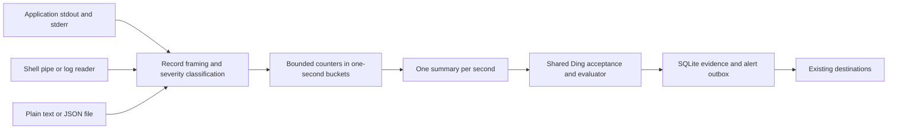

# Live log monitoring implementation plan

Proposed October 11, 2026. Build live application-output monitoring into Ding, with collection and aggregation in a separate internal component. Start by capturing stdout and stderr from an application launched through Ding, or consuming an existing output stream through a pipe. Support ordinary text and structured JSON as parsing options on every transport. Reuse the collector for daemon-managed files and log-reader commands.

Implemented on `codex/live-log-capture` in small commits. The current user contract is in [Live application logs](../guides/logs.md), and measured results and remaining release qualification are in [Log qualification](log-qualification.md). The design below records the original proposal; implementation choices and qualification limits take precedence where noted here.

## Implementation status

- Foreground exec/stdin capture, native external sessions, daemon file/command readers, explicit severity mappings, multiline framing, readiness, and gap handling are implemented.
- Console setup, sample classification, live evidence, shared inspection/MCP contracts, revision grants, and one-hour default summary retention are implemented. Local daemon readers are limited to eight concurrent slots, independently of polling workers.
- Versioned session state and available file positions use the existing transactional source cursor. No SQL schema migration or bucket restoration is needed: every interrupted collector rebuilds evidence instead of resuming a persisted counter window. Rotation drains the old file to EOF and starts at the replacement's end with an explicit gap.
- Snapshots freeze their second-aligned boundary when queued. Native sessions accept each completed second once; retries acknowledge the same durable receipt. EOF records the end of collection and holds incidents; it does not evaluate an unfinished second.
- macOS functional, race, browser, and short load checks have passed. The proposed one-hour baseline, ten-stream sweep, 24-hour soak, RSS/CPU qualification, and Linux runtime qualification remain release gates, not demonstrated capacity promises. Windows capture remains disabled.

## Intended experience

A developer runs an application through Ding or connects its existing log stream and creates a watch: “Alert when detected warnings exceed 50% of output records in the last minute, with at least 100 records.” The application does not need to change its logging library, write a file, or emit JSON. Ding preserves visible application output, updates counts every second, and delivers firing and recovery notifications through existing destinations.

The Console shows detected warning and error percentages, underlying counts, classification coverage, window boundaries, and collection status. A quiet application, stopped process, ended pipe, unreadable file, incomplete window, and exceeded threshold must have distinct explanations. Foreground capture lasts as long as that session; daemon-managed readers continue after the terminal or model client closes. Capturing output does not turn a foreground application into a background service.

## Initial scope

Ship stdout/stderr capture and stdin ingestion on macOS and Linux first. Make plain-text parsing and structured JSON parsing available from the first working slice. One watch represents one configured application stream; retain the originating stdout/stderr channel when the transport provides it. Add file following and daemon-owned log-reader commands after the core stream path works.

The initial defaults are a 60-second window, one-second publication interval, and 100 minimum records. Live capture starts with new output; files default to their current end. Offer shorter windows through validation, with whole-second boundaries and bounded resource use. A short-lived command may finish before these defaults provide enough evidence; report that outcome and allow a smaller configured window/count without silently changing the rule.

Support explicit text patterns and optional bounded multiline framing in the first product release. Defer native Docker/Kubernetes/journal API adapters, remote collectors, application-level grouping, raw-log search, LLM analysis, PTY emulation, and application supervision. Existing log-reader CLIs can feed the stream path before dedicated integrations exist. Windows requires native pipe, signal, process-tree, and file-rotation qualification before it is advertised.

## Capture modes and application ownership

Input transport and log format are independent. JSONL means one JSON object per line; that content can arrive over stdout, stderr, a pipe, or a file. Plain-text logs can use the same transports. Library documentation establishes format options, not a population-wide JSONL adoption percentage: for example, Go provides both [text and JSON slog handlers](https://pkg.go.dev/log/slog).

Proposed CLI examples, for an already configured watch named `api-logs`:

```sh
# Launch an application and capture both streams while showing its output.
ding logs exec --watch api-logs -- npm run dev

# Receive ordinary text from a shell pipeline.
my-app 2>&1 | ding logs ingest --watch api-logs

# Observe output already exposed by a container runtime.
docker logs --follow --tail 0 my-app 2>&1 | ding logs ingest --watch api-logs
```

| Mode | Ding owns | Lifecycle |
| --- | --- | --- |
| `logs exec` | The explicitly launched child and its capture pipes | Forward signals and preserve exit status; do not auto-restart the application |
| `logs ingest` | The stdin reader and summary sender | EOF ends the session; producer supervision stays with the shell or existing supervisor |
| Daemon log-reader command | A configured observer such as a log-following CLI | Stop/reconnect the observer according to policy; it does not own the application being observed |
| Daemon file follower | Read-only file descriptors | Follows append/rotation while the daemon runs |

For an already-running application, connect to its existing log destination or supervisor. There is no general portable interface that lets Ding attach to any PID and receive a faithful duplicate of previously configured stdout/stderr. Do not implement attachment by consuming another reader's pipe or promising retrospective output. Docker exposes container stdout/stderr through [its logging interface](https://docs.docker.com/engine/logging/); availability depends on the configured driver.

Merged pipelines lose channel identity. A producer CLI can also mix its own diagnostics with application output; label that source and offer explicit filters. Dedicated adapters can later distinguish transport errors from application records. Applications that produce only files or platform logs need the corresponding reader. Interactive full-screen programs and arbitrary binary output are outside initial support.

## Existing foundation and required changes

| Area | Existing behavior | Planned change |
| --- | --- | --- |
| Ingestion | `internal/watchrun/ingest.go` projects JSON and immediately enters durable acceptance | Use existing push for the prototype; native collection later submits the same summary fields to shared acceptance |
| Sources | HTTP and command polling plus JSON push; commands complete before evaluation | Add streaming capture and long-lived readers with explicit ownership |
| Conditions | Typed scalar comparisons and exact numeric windows | Compare a precomputed ratio; keep raw log events outside numeric sample windows |
| Readiness | Unknown input holds incidents but emits source-health errors | Add an explicit waiting result for a healthy source with insufficient evidence |
| Persistence | `internal/watchrun/app.go` atomically commits observations, state, events, and delivery intents | Commit session/checkpoint state with each summary; pipes have no replayable file offset |
| Presentation | CLI, Console, and MCP share watch contracts | Add log authoring, permissions, collection diagnostics, and summary evidence |

The current evaluator scans retained numeric samples and persists entity state for each observation. Its default sample budget is 10,000. Sending each log event through that path would tie database traffic and window state to application log volume. Instead, count events near the reader and persist one summary per publication interval.

The [existing capacity fixture](qualification.md#capacity-fixture) measures a different workload. Its six-minute recovery check recorded 18,270 accepted pushes and a burst commit p95 upper bound of 21 ms; it excludes ingestion HTTP transport and is not evidence of log collection capacity. Establish a separate log benchmark.

## Component boundaries



Put transport-neutral framing, classification, and bucket accounting in a new `internal/logs` package, with separate exec, stdin, command-reader, and file adapters. It owns no alert thresholds, notifications, or Ding database writer. Give it an explicit clock and immutable snapshot/checkpoint outputs so arithmetic and failure behavior are testable without real-time sleeps.

The prototype adds `ding logs exec` and `ding logs ingest`. Use these names because the existing top-level `ding run` deliberately provides legacy migration guidance. Read the ingest credential rather than reusing `control.Connect`, which loads the admin credential. Post scalar summaries through `/v1/ingest/{watchId}` with one stable idempotency key per immutable snapshot. Prototype flags declare the parsing and window configuration explicitly.

For the shipping external-capture mode, add a versioned collection-session API for `source.type: logs`. An authenticated handshake returns the applied parsing/window configuration and a session identity bound to daemon instance, watch revision, and generation. Allow one active producer per watch. Subsequent summary, heartbeat, and end-session messages validate identity, sequence, freshness, and count consistency before shared acceptance. Retried messages are idempotent; an ended/replaced session cannot resume silently. The handshake exposes only the producer configuration, not admin credentials or unrelated watch data.

Daemon-owned readers run the same package under `internal/watchrun` and submit summaries directly to acceptance. Use separate collector limits and bounded queues; a reader must not occupy an acquisition slot forever or starve polling/delivery workers. The daemon remains the only writer of Ding state.

The exec wrapper uses explicit argv with no inserted shell, inherits the invoking user's working directory/environment and stdin, drains stdout and stderr concurrently, and forwards each original byte stream to its corresponding output. Keep diagnostics off stdout. Preserve order within each stream; do not claim a total ordering between stdout and stderr. Reuse or extract process-group primitives from `internal/source` only after separating their poll-timeout/forced-kill behavior from the wrapper's signal and exit contract. Review [Go subprocess pipe and wait semantics](https://pkg.go.dev/os/exec) when implementing drains and descendant cleanup.

Pipes can change an application's buffering or color behavior because they are not terminals. Document this and test explicit unbuffered producer settings; never promise delivery before the application flushes. PTY support is separate work. Notification/store delays must not stop pipe draining: isolate analytics with a bounded queue and report dropped analysis as a gap. Output forwarding retains ordinary downstream backpressure; do not promise both unbounded lossless output and a producer that can never block. Monitoring failures after launch must not kill the application or replace its exit status.

## Parsing ordinary output

Offer `text`, `jsonl`, and `auto` formats independently of transport. Auto tries a configured JSON severity field for object-shaped records, then a named text profile. Text profiles recognize severity in defined header positions, including common timestamped `WARN`, `WARNING`, `ERROR`, `INFO`, and `level=...` forms. Use anchored or bounded patterns, not arbitrary substring searches: “0 errors” must not become an error record. Support explicit user patterns and aliases, and show their matches in a preview before activation.

Do not infer severity solely from the output channel. Python's [StreamHandler](https://docs.python.org/3/library/logging.handlers.html#streamhandler), for example, defaults to stderr for logging at any enabled severity. Preserve channel as independent metadata; an explicit user rule may choose to match it.

Default framing counts complete nonblank lines. Normalize CRLF and remove ANSI control sequences only in the analysis copy; preserve original passthrough bytes. Carriage-return progress updates require a declared framing rule. Offer explicit bounded start/continuation patterns for multiline logs, with maximum bytes/lines and a flush deadline. Grouping is per stream; never join a stdout line to a stderr traceback. Without such a profile, label the denominator “lines,” not “messages.” With it, label the denominator “records” and count a stack trace once. Flush an unterminated record at EOF and mark its boundary.

Unmatched text is `unclassified`, not healthy/info. Auto mode must tolerate ordinary non-JSON lines. In explicit JSONL mode, malformed JSON is a parser error. Show the fraction of records whose severity was recognized and the profile used. Fully generic semantic classification of arbitrary prose is not guaranteed by these rules.

## Counts and time semantics

Use collection time for the first version: the time a record is completed by the reader, including an explicit multiline flush. Application timestamps are not used to place events into windows. Describe the feature as “records collected in the last minute.” Historical replay and application event-time windows require a later contract.

Maintain a ring of one-second buckets with integer counts for trace, debug, info, warning, error, fatal, and unclassified records. At second boundary `T`, publish the completed buckets covering `[T - window, T)`. This is exact counting for the declared second-aligned window, evaluated once per second; it is not an arbitrary-time sliding window or a sample of the input. Expire buckets and publish even when no new records arrive.

Derive ratios from summed counts. `warning_match_ratio = warning_count / total_count`; `error_match_ratio = (error_count + fatal_count) / total_count`. Label these “detected warnings” and “detected errors or fatal,” with all records, including unclassified ones, in the denominator. Also report `classification_coverage = classified_count / total_count`. These are rates of explicit rule matches, not proof that every unmatched line is non-error. An optional minimum coverage requirement can make a snapshot ineligible when its labels are insufficient. Never average per-bucket percentages.

Count every complete nonblank record attempt in `total_count`; ignore blank lines. Unmatched text remains eligible for a detected-pattern rule and increases `unclassified_count`. Explicit format errors, invalid UTF-8, oversized records, and capture loss make the window incomplete. This distinguishes legitimate unlabelled output from damaged or missing input. On configuration, show the exact match-rate definition and coverage requirement so the alert cannot imply certainty the parser does not provide.

Bound record size at 64 KiB initially. Drain an oversized line or configured multiline record to its next framing boundary using bounded memory, count it once, and report the failure. Keep partial records in bounded memory. File offsets advance only through complete records; live pipes have no resumable offset. Do not persist raw message text in checkpoints or summaries.

Proposed summary fields are flat scalars so they work with existing push projection:

```json
{
  "summary_version": 1,
  "stream_id": "api",
  "epoch": "collector-session-id",
  "summary_sequence": 42,
  "window_start": "2026-10-11T19:00:00Z",
  "window_end": "2026-10-11T19:01:00Z",
  "window_seconds": 60,
  "total_count": 1000,
  "warning_count": 620,
  "error_count": 40,
  "fatal_count": 0,
  "unclassified_count": 100,
  "classified_count": 900,
  "classification_coverage": 0.9,
  "warning_match_ratio": 0.62,
  "error_match_ratio": 0.04,
  "parser_profile": "common-text-v1",
  "framing": "line",
  "complete": true,
  "ready": true,
  "reason": "ready",
  "lag_bytes": null
}
```

Ratios used for evaluation are null when the window is incomplete, warming up, below the minimum count, or below a configured coverage requirement. Store counters and reason fields regardless. Idle zero-volume windows are waiting, not 0% warnings. `complete` means continuous collection for the whole window with no known loss or framing/format errors; `ready` additionally requires the minimum count and configured coverage. For pipes, upstream buffering/lag may be unknowable: report it as unavailable, not zero. Snapshot identity is scoped to watch generation, collector epoch, and sequence. Reject counter overflow and nonfinite arithmetic explicitly.

## Alert and readiness behavior

Keep threshold evaluation in Ding. The collector reports counters, ratios, and evidence readiness; it never decides whether to fire or recover an incident. For the default watch, one ready snapshot above 0.5 fires once; three consecutive ready snapshots at or below 0.5 recover. These are three successive evaluations of overlapping windows, not three independent minutes of data. Separate firing and recovery thresholds are deferred.

| Input state | Condition behavior | User-visible behavior |
| --- | --- | --- |
| Ready, ratio above threshold | Match and use existing transition policy | Firing incident with counts and window |
| Ready, ratio at or below threshold | Nonmatch and advance recovery count | Recovery after the configured count |
| Warmup, too few records, or insufficient required classification coverage | Reset pending match/recovery streaks; hold an open incident | Waiting, with count and coverage |
| Parsing failure, read failure, lag, or collection gap | Unknown; hold incident and reset streaks | Source-health problem with a specific reason |
| Collector stops producing summaries | Source becomes unhealthy after a bounded deadline | Collector stalled; never infer application recovery |
| Process exits or stdin reaches EOF | Close the collection session and stop freshness heartbeats; hold the incident | Collection ended, with exit status when known |

Add a distinct waiting observation/evaluation path and update replay and inspection accordingly. Do not reuse HTTP `unchanged` observations: their existing semantics preserve streaks and intentionally do not prove source recovery. Separate source liveness from condition readiness so a healthy reader can recover from a file error while still warming up. A waiting result must not close the application's open incident.

The experimental push prototype can send null ratios to invoke the current unknown-input behavior. Document that it displays source errors for insufficient data. Native readiness/session support is required before release; raw `health` keys in pushed JSON do not currently set observation health. An application's exit code is separate from the severity of its output; a later process-exit rule can alert on it explicitly.

## Proposed watch declaration

This is a design example; the current compiler must continue rejecting it until the schema work lands. `source.logs` settings control collection and eligibility. Existing scalar conditions and notification policies remain in use.

```yaml
apiVersion: ding.ing/v1alpha1
kind: Watch
metadata:
  id: api-log-warnings
spec:
  source:
    type: logs
    logs:
      input:
        type: external
      format: auto
      textProfile: common
      framing: line
      window: 60s
      emitEvery: 1s
      minEvents: 100
  condition:
    field: warning_match_ratio
    operator: gt
    value: 0.5
  policy:
    trigger: transition
    consecutive: 1
    recoverAfter: 3
    onUnknown: hold-incident
    maxGap: 5s
  destinations:
    - ref: desktop-alerts
      events: [firing, recovered, source_error, source_recovered]
```

The destination must already exist. `input.type: external` waits for `logs exec` or `logs ingest` to establish a producer session; applying it launches no application. A file input declares an absolute path and start position. A command input declares explicit argv, absolute working directory, private environment references, and bounded observer-reconnect policy. It runs a log reader under the daemon, not a periodically repeated application command.

Compile bounded windows, record sizes, text patterns, aliases, and collector limits; proposed initial maximum window is one hour. Reject unrelated polling settings and arbitrary jq projection. Changing the input, parsing/framing rules, window, or minimum count changes the execution fingerprint and starts fresh evidence. Preserve existing reset rules for incompatible watch changes. Preview affected process ownership and lifecycle behavior separately from condition changes.

## Sessions, files, and interruptions

For exec capture, launch only after validating the watch and capture configuration. Forward supported termination signals to the owned child process group and drain both streams concurrently. Coordinate process waiting and pipe closure so waiting cannot prematurely discard unread output; bound final drains and descendants that retain pipe handles. Send a best-effort final session status and return the child's exit status. Ingest mode never signals the external producer. A broken forwarding sink and a failed analytics sender are different failures; test their behavior separately.

For daemon command readers, pause/remove stops the owned observer and preserves the independently managed application. For external sessions, pause disables analysis while the wrapper keeps draining and forwarding application output; resume obtains a fresh session and warms up. Never automatically rerun a user application when an external session disconnects or the daemon restarts.

Follow regular files read-only under the daemon user's permissions. Capture platform file identity, the complete-record offset, and a small identity fingerprint. Handle rename-and-create rotation by draining the previous open file and discovering its replacement, while keeping both descriptors and rotation queues bounded. Treat copytruncate or ambiguous replacement as a gap and reset readiness; do not claim lossless capture of bytes an application removed before Ding read them. Partial records abandoned during rotation are also visible gaps.

Add versioned session/checkpoint state under the existing store, scoped to watch generation. Atomically commit snapshot identity, available transport positions, bucket state, and the corresponding summary/evaluation/outbox writes. In-memory progress becomes authoritative only after acceptance commits. Use immutable checkpoint copies when reading continues during a commit. Schema migration, backup, restore, revision replacement, duplicate-session admission, and stale-runner rejection must cover this state. A durable summary receipt is not a guarantee that every raw pipe byte survives a crash.

After daemon/collector interruption, record a gap and rebuild the live window while preserving open incidents and committed deliveries. Files resume at their current end; command readers use a configured live-only start; external producers reconnect only while their existing process/session remains active. File checkpoints identify skipped byte ranges where possible; pipe loss may have an unknown extent. Do not replay old backlog as current application behavior or auto-relaunch an application. Lossless catch-up requires a retained source and a later event-time contract.

Bound outstanding snapshots and the time they may spend waiting to commit. A late snapshot must be classified as stale before evaluation because the engine uses acceptance time. On overload, continue draining live application pipes, count known analysis drops, mark a gap, and reset readiness. Files may resume at their current end; observers may reconnect to their live stream. Never discard analysis while maintaining a healthy status. In the push prototype, retry an immutable snapshot/key within its freshness limit; expire stale work and surface the gap rather than draining old ratios into live alerts.

Publish idle summaries every second while the source/session remains live; detect absent collector heartbeats within five seconds. A quiet pipe is not itself a stalled collector. Track read-loop health, internal queue depth, and commits separately; expose upstream lag only when observable. Detect missed ticks, known excessive lag, and clock/suspend discontinuities, then reset readiness. Shutdown cancels owned readers and follows bounded commit/delivery behavior; it must not imply that external applications can survive arbitrary capture-process termination.

## Authoring, inspection, and permissions

Extend `internal/watch/types.go`, `internal/plan`, generated watch JSON Schema, descriptions, and validation fixtures. Add collector/readiness fields to inspection and Console contracts without relabeling existing HTTP or push states. Update the shared read models and contract generation before wiring the UI.

The Console flow first selects application launch/piped input, existing log-reader command, or file. Ask for text/JSON/auto parsing, show a transient sample classification preview, and then configure the detected warning/error metric, threshold, window, minimum count, optional coverage requirement, and destination. For external capture, provide the command to run and show “waiting for application output” until a session connects. Explain foreground versus daemon lifetime. Show stream provenance, parser profile, unclassified count, coverage, window, last summary, session/exit state, and observable lag. Persist summaries and failure codes; preview text is bounded and not retained by default.

Treat file reading and daemon-owned command execution as explicit source permissions. Extend integration-grant checks to cover the approved log-source revision; a generic manage grant must not authorize new file reads or executable launch. Show the path or observer argv and execution location in preview. An external-source watch does not authorize an API caller to launch arbitrary applications; foreground exec is an explicit local invocation. Keep cloud/transfer rejection for local sources and qualify file replacement behavior. Credentials and raw application output must not leak into collector diagnostics.

## Implementation sequence

| Phase | Deliverable and main code areas | Depends on | Acceptance evidence |
| --- | --- | --- | --- |
| 1. Stdout and stderr prototype | New `internal/logs`, `logs exec`/`logs ingest`, text/JSON/auto classifiers, synthetic subprocess | None | An unchanged plain-text application retains visible output and exit status while live summaries produce the expected alert through the existing push API |
| 2. Native contract and sessions | Watch/compiler/schema changes; authenticated external sessions; waiting/ended semantics; permissions | Phase 1 contract | Applied watch config reaches the producer; duplicate/stale sessions are rejected; low evidence cannot fire or recover; collector stalls and clean EOF are distinct |
| 3. Durable readers and lifecycle | Store migration, checkpoints, daemon command/file readers, multiline profiles, rotation, signals, restart, pause, pressure | Phase 2 | Fault injection across commit and process boundaries; bounded drains; observer shutdown leaves its application running; honest gaps and preserved incidents |
| 4. Product surfaces | Console authoring/detail/evidence, CLI inspection, MCP descriptions/grants, examples and guide | Phases 2–3 | Create, preview, apply, inspect, pause, resume, and remove a log watch through supported surfaces; terminal closure leaves collection running |
| 5. Qualification and release | Stream capacity driver, real application fixtures, platform tests, failure matrix, published limits | Phases 1–4 | Plain text and JSON work over exec/pipes and daemon readers; signal/output behavior, sustained load, and coexistence targets pass on macOS/Linux |

Keep each phase reviewable as a PR or a small series. Phases 1–3 establish correctness and performance before extensive UI work. The first demo must use a normal text-emitting application through stdout/stderr; a JSONL-file-only demonstration does not satisfy the first milestone.

## Correctness and capacity gates

Use parser fixtures and a deterministic reference counter for text headers, JSON fields, mixed formats, ANSI/CRLF, unmatched text, false-positive phrases such as “0 errors,” coverage requirements, multiline stacks, bucket boundaries, bursty/unequal volumes, exact 50% comparisons, zero traffic, and expiration. Verify that unknown/waiting intervals break pending streaks and that records age out during silence.

Subprocess tests must cover simultaneous high-volume stdout/stderr, byte-preserving passthrough, stdin, exit codes, Ctrl-C/termination forwarding, child-held pipe descriptors, EOF without newline, buffering, broken downstream output, and analytics failure without killing the child. Test merged-stream provenance and command-reader diagnostics. Include split/oversized records, file failures/rotation/truncation, commit-boundary crashes, duplicate sessions, lost responses, 429/503 backoff, full storage, slow destinations, watch replacement, and suspend/resume. Verify replay from retained summaries; it cannot reconstruct unretained raw output.

Proposed targets, to validate rather than advertise in advance:

| Workload or metric | Target |
| --- | --- |
| Baseline | 1,000 records/second for one hour, representative 1 KiB records; run text and JSON separately over exec, stdin, and file readers |
| Stress sweep | 10,000 events/second bursts for 60 seconds; measure both 1 and 10 streams with total load reported |
| Steady-state latency | p95 at most 2 seconds from a threshold-changing producer flush to durable firing event, after warmup and configured consecutive checks |
| Local delivery | p95 at most 3 seconds to a counting console sink; report external destination timing separately |
| Persistence rate | At most one ordinary summary/checkpoint commit per stream per second; measure alert/health writes separately |
| Collector memory | Incremental RSS for one stream at most 32 MiB over the same daemon without collection; bounded growth as raw event count increases |
| Shared runtime | Existing HTTP/push workload continues meeting its qualification targets during log collection |
| Duration | An uninterrupted 24-hour run at the selected supported rate with zero unexplained count loss and bounded retained storage |

Use an independent writer schedule and an oracle for declared collection-time windows; report producer buffering and reader delay separately. Record offered/consumed rates, output forwarding delay, bytes, parse failures, classification coverage, known lag, queue drops, missed deadlines, gaps, commits, outbox delay, CPU, memory, and database/WAL growth. State hardware, OS, filesystem, transport, watch count, record sizes, and retention. Report warmup separately from steady-state latency, and do not count a blocked producer as maintaining offered load.

At one summary per second, one stream creates 86,400 observations per day before retention. Measure actual storage and pinned incident evidence before choosing defaults. Use an explicit one-hour retention setting for the first qualification fixture; the existing seven-day runtime default must not become an unmeasured log-history promise. Before release, either demonstrate safe defaults at the documented stream count or implement an explicit compatible retention setting for log summaries. Never silently shorten unrelated watch history.

## Release decision

Release when ordinary text and JSON output can be captured without application code changes, the wrapper's stream/signal/exit behavior is qualified, and watches explain classification limits and collection gaps while meeting measured load targets. Publish transport and parsing support, foreground/background ownership, platforms, stream count, rate, retention, and restart behavior together. Native platform adapters, PTY behavior, application supervision, full-text storage, and lossless historical processing remain separate extensions.
