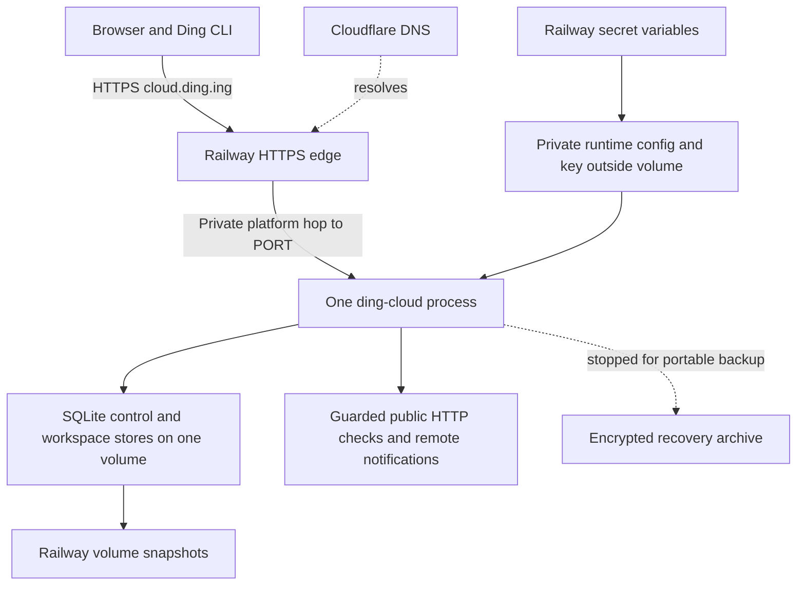

# Basic Ding Cloud on Railway

Updated October 11, 2026. **The first private owner instance is deployed at https://cloud.ding.ing.**

Run the existing Ding Cloud service on Railway with SQLite on one persistent volume. Reuse the new shared-account foundation and Console. The owner selected Console alerts only for this first deployment; external notification delivery is a later qualification step.

This is the current execution plan for the [broader cloud roadmap](ding-cloud-plan.md). It incorporates the [shared accounts work](shared-accounts-plan.md), implemented in 44 commits on `codex/shared-accounts` through `766d9ff`. PRs #32 and #33 are merged; implementation starts from main at `bbd2104` in `codex/railway-cloud`. A01–A06 exist in source. Company SSO and additional self-hosted workspace administration are separate follow-ups.

Railway and SQLite are the selected starting architecture. Sign-in uses **invite-only built-in accounts**; the existing OIDC option remains available. Supabase/PostgreSQL is deferred. Cloudflare DNS points `cloud.ding.ing` directly to Railway, whose certificate is valid.

## Implementation status

| Work | Evidence and remaining scope |
| --- | --- |
| R1 Built-in cloud accounts | Implemented independently of execution policy. Owner login, invitations and revocation pass Chromium, WebKit and Firefox browser tests. Cloud restrictions and existing OIDC tests remain enforced. |
| R2 Railway HTTPS/readiness | Implemented and deployed; public HTTPS, canonical origin, Secure cookies, CSRF, private metrics and maintenance probes verified. |
| R3 Persistent runtime | Dedicated image/startup helper and `.railway/railway.ts` pin one commit, replica and volume. Non-root runtime, missing-mount/key refusal, restart, crash and writer exclusion pass qualification. Hosted redeploy preserved sessions and watch state. |
| R4 Recovery | Actual Railway maintenance/export/download/fresh-directory restore passed. Old sessions were rejected, the encrypted credential was recovered and restored watches stayed paused. Daily/manual Railway snapshots require a Pro workspace and are **not enabled**; actual Railway snapshot recovery remains unqualified. |
| R5 Owner journey | Domain, owner login and public HTTP checks work. The owner requested `freedesign-http`, checking `https://freedesign.md` every five minutes for status >= 400, with Console alerts only. External delivery and laptop-off receipt are deferred by that choice. |
| R6 Wider pilot | Live transfer qualification, continuous external health monitoring, a representative 72-hour soak and cost/capacity measurements remain before inviting a wider cohort. |

The [operations runbook](../../deploy/railway/README.md) records startup, maintenance, portable recovery and verification. The active directory is `/data/restored-20261011`, selected after the hosted recovery drill; `/data/ding` is the inactive original. The data key and recovery identity are held separately from the volume and encrypted archive. This is an owner pilot, not a qualified wider beta.

## First release scope

| Decision | First private instance |
| --- | --- |
| Address | `cloud.ding.ing`; use this as the canonical origin throughout config and clients |
| Runtime | One always-running `ding-cloud` process in one Railway service and region |
| Storage | One volume at `/data`; identity/control database and separate workspace SQLite stores under `/data/<DING_STATE_NAME>` |
| Access | Named owner, one initial workspace, manually shared invitations for trusted collaborators |
| Login | Built-in passwords, existing Argon2id/session/recovery code; no public registration or email service |
| Execution | `hosting=cloud`: public HTTP sources, guarded remote delivery, existing quotas and retention |
| Initial limits | Existing three-watch, five-minute minimum, seven-day ordinary-history and 64 MiB per-workspace policy; existing request/delivery budgets remain enforced |
| Clients | Browser Console and authenticated CLI/device connection; selected-watch transfer after the direct cloud-watch journey works |
| Initial users | Owner first. Invite a small trusted group only after recovery and sustained-execution checks pass |
| Cloudflare | Authoritative DNS initially. Optional proxying after the Railway origin works |
| Deferred | Public signup, billing, marketplace submission, public OAuth MCP onboarding, extra login providers, automatic failover, multiple execution replicas and database migration |

Invitees in this first workspace share its watches and retained evidence according to the existing roles. This is not an enrollment flow for unrelated customers. Keep the multi-workspace model and isolation tests, but do not build a customer provisioning dashboard to launch the owner pilot.

`cloud.ding.ing` is the canonical origin for cookies, device connections and future OAuth callbacks. The user added Railway's exact CNAME and TXT verification records in Cloudflare.

## Reuse the auth work

| Existing implementation | Use in this release |
| --- | --- |
| `internal/access` | User/workspace principals, four roles, capability checks and reviewed-mutation authorization |
| `internal/identity` | Password hashing and the existing OIDC provider implementation |
| `internal/serverstate` | Users, memberships, sessions, invitations, audit, encrypted credentials and workspace metadata |
| `internal/cloud` | Hosted API, execution pool, network policy, quotas, device login, transfer handling and metrics |
| `internal/cloudbackup` and `internal/serverops` | Exclusive offline backups, quarantined restores, revocation and operator recovery |
| Console account/member views | Shared login shell, invitations, roles, password/session controls and audit |
| `Dockerfile.cloud` | Embedded Console/MCP asset build and the Go cloud binary |

The main integration gap at the start was that passwords and invitations depended on `Server.Shared`, while that self-hosted choice also changed acquisition policy. R1 resolved this with explicit `loginMethods` and discovered account features. **Do not deploy with `hosting=self-hosted` just to get password login.** That changes the network and execution restrictions.

Separate enabled login methods from hosting policy in configuration and capability discovery. A built-in cloud login must retain all cloud restrictions. Update the password, activation, reset, member and account UI gates to use auth capabilities rather than `execution === "shared"`. Keep execution labeled Ding Cloud. OIDC remains a supported, separately configured method; an unavailable provider never enables another access mode automatically.

Expose cloud bootstrap and host recovery through operator commands that reuse the shared services. The present `ding server init` explicitly requires self-hosted hosting, so it is not the cloud bootstrap command. Initialization must be one-time, transactional and unavailable over the public API. Use fresh state; no legacy account migration or conversion of the owner's local database is needed.

Public MCP remains disabled when no OAuth issuer is configured. Built-in browser sessions and CLI device tokens do not become MCP bearer tokens. Hide unavailable model-connection setup in the Console. Retain the existing OIDC/MCP tests and add real-provider qualification when enabling that feature later.

## Deployment shape

Use one service for UI, API, identity metadata and scheduling. Avoid a separate database service, frontend deployment or Worker for this milestone. Railway volumes do not support replicas and deployments with a volume incur a short interruption while ownership changes. Preserve Ding's OS locks in addition to Railway's deployment behavior. [Railway volume constraints](https://docs.railway.com/volumes/reference)

Turn Railway Serverless off explicitly: checks must continue without web visitors, including long intervals and periods when all watches are paused. Start with a measured small instance and volume; record actual CPU, RSS, disk/WAL growth and cost during the owner pilot. Do not treat the old synthetic 100-workspace benchmark as Railway sizing evidence. [Railway Serverless](https://docs.railway.com/deployments/serverless)

## Implementation sequence

The following sections retain the implementation requirements and wider pilot gates. Use the operations runbook for the implemented commands and configuration.

### R1 Enable built-in accounts under cloud policy

Add explicit enabled login methods, persist/validate the selected profile, and allow built-in cloud startup without an OIDC issuer. Reuse the existing password/session/invitation services. Add cloud operator initialization and password recovery, and make discovery report available account and model-connection capabilities.

Bootstrap the owner and first workspace with private input before public readiness. Repeated ordinary startup must not reset a password, recreate a deleted workspace or create another owner. Recovery must remain an explicit operator action that revokes affected credentials. Keep public enrollment closed; the existing enrollment count alone is not an invitation or identity allowlist.

**Acceptance:** owner login, viewer/editor invitations, password reset and session revocation work in cloud mode. Browser and CLI permissions agree. Command, private-IP, unsupported push, unapproved credential use and cross-workspace requests still fail. Personal account-free startup and existing cloud OIDC flows pass regression tests.

### R2 Support Railway networking explicitly

Add an explicit edge-terminated TLS deployment mode. It permits the application to bind `0.0.0.0:$PORT` behind Railway's HTTPS edge while retaining an HTTPS `publicURL`, Secure cookies, CSRF and exact canonical Host/Origin checks. Default non-loopback plaintext rejection remains in place for ordinary deployments. Do not enable this mode from untrusted request headers or infer identity from a forwarded header.

Railway injects `PORT` and uses `healthcheck.railway.app` for deployment probes. Allow that Host only for a minimal `GET /healthz`; reject it for login, UI and API routes. Readiness must reflect initialized state and a ready worker pool. Give probes a bounded path that user login throttling cannot starve. Railway's check only gates deployment, so add independent ongoing monitoring. [Railway healthchecks](https://docs.railway.com/deployments/healthchecks)

Audit proxy effects on password throttling: `RemoteAddr` may identify an edge proxy. Preserve per-account and global hash-work limits; do not trust an arbitrary `X-Forwarded-For` value to bypass limits. Accept a client-IP header only after establishing and testing Railway's actual trust boundary. Verify HTTPS-only public access, host preservation and spoofed headers on the deployed service.

**Acceptance:** the production image accepts real Railway probes and public HTTPS requests; wrong hosts/origins and spoofed identity headers fail; a failed worker is unhealthy; direct deployments keep their current TLS validation.

### R3 Package startup and persistent state

Add a Railway-specific image/startup path and config-as-code file under `deploy/railway`. Build from the repository root with the existing asset build. Pin the deployed commit/image, set one replica, disable sleeping and configure graceful termination. Start with deployment overlap set to zero and a 60-second draining window, then verify it exceeds measured shutdown time. [Railway teardown configuration](https://docs.railway.com/deployments/deployment-teardown)

Use Railway secret variables for the cloud config and a separately generated, stable 32-byte data key encoded for transport. Materialize them as owner-only files in a private runtime directory outside `/data`. Do not generate a replacement encryption key at each boot, store it in the volume, include it in the image, or print it in diagnostics. Keep a protected recovery copy outside Railway. Bootstrap password input is separate, consumed only by explicit initialization and removed after success.

The current image runs as UID 10001; Railway volumes initially have root ownership and are unavailable during build/pre-deploy. Add a narrow Linux startup helper that initializes only the expected state/runtime directories, sets their ownership and drops to UID/GID 10001 before starting Ding. Preserve strict private-file checks; do not make the database world-writable or run the long-lived server as root. Test a fresh volume and a reused volume. [Railway volume lifecycle and permissions](https://docs.railway.com/volumes)

Normal start, one-time init, backup and recovery must be explicit startup modes with clear exit behavior. Do not run database setup in a pre-deploy command. Fail if persistent storage, the key, the hosting profile or the schema is wrong. Shut down workers and delivery before releasing store ownership.

**Acceptance:** restart and redeploy preserve users, credentials, watches, history and delivery state; the server runs without root privileges; a second writer is rejected; shutdown and crash/restart do not lose committed work. Existing personal/self-hosted images still build.

### R4 Establish backup and recovery on Railway

Enable Railway's daily volume snapshots for the owner pilot and take a snapshot before state-changing releases. Railway supports SQLite volume backups; its snapshot restore redeploys the service with a restored volume. Treat snapshots as an additional recovery source, with a separate tested Ding recovery procedure. [Railway backups](https://docs.railway.com/volumes/backups)

Replace the systemd-dependent backup instructions with a tested maintenance procedure on the **same service and volume**. Stop the serving process, obtain the exclusive lock, run the existing encrypted backup operation, download the completed archive to protected off-platform storage, then resume normal startup. Prove this using Railway's actual supported CLI/maintenance controls; a second cron service cannot assume access to the volume. The owner pilot can use manual portable exports; unattended off-platform export is a later operations increment.

Before inviting other users, test restoration into a fresh data directory with the former runner stopped. Reuse quarantine, session/grant revocation, paused watches and canceled stale deliveries. Reapply workspace deletions and inspect unresolved transfers before releasing quarantine. Keep keys separate from snapshots and archives.

Railway snapshot restore must start in an explicitly selected recovery/maintenance mode before ordinary execution is allowed. A raw filesystem rollback alone does not invoke Ding's quarantine or revoke old credentials. The runbook must route snapshot contents through the existing safe restore process; add a small operator helper if needed. Disable automatic normal deployment during this procedure. Measure the actual data-loss window and recovery time, and record the maintenance monitoring gap.

**Acceptance:** recover a real synthetic workspace and encrypted credential on a fresh directory; old sessions fail; restored watches stay paused until reviewed; no stale notification is replayed. Inspect both a portable archive and a Railway snapshot recovery.

### R5 Connect the domain and run the owner journey

Create the Railway service/domain registration, then give the user the exact DNS records from Railway. Configure `https://cloud.ding.ing` as the sole application origin. The current Railway flow supplies a CNAME target and TXT ownership verification; copy both exactly, with no invented target or wildcard. [Railway custom domains](https://docs.railway.com/networking/domains/working-with-domains)

Start with the CNAME set to **DNS only** in Cloudflare so Railway handles public HTTPS directly. Cloudflare proxying is optional and can follow qualification. If enabled, use Full (strict), verify the Railway origin certificate, preserve Host, and bypass caching for authenticated pages, API, auth, device and MCP paths. Apply changes to this hostname rather than changing unrelated site settings. [Cloudflare proxy status](https://developers.cloudflare.com/dns/proxy-status/), [Full (strict) TLS](https://developers.cloudflare.com/ssl/origin-configuration/ssl-modes/full-strict/)

Log in as the owner, save one remote notification destination, receive the labeled test, create a public HTTP watch and observe a real check. Close the browser and turn off the laptop; trigger and receive a real alert. Restart/redeploy Railway and confirm continued execution. Test one invited viewer and editor before enabling further invitations. Keep operator metrics private and monitor public health from outside this Ding instance.

**Acceptance:** the canonical domain and HTTPS work, authentication/roles work, a real notification arrives with the laptop off, and redeployment preserves operation. The owner can inspect failures, revoke a session and recover access.

### R6 Qualify transfer and widen the private pilot

Exercise the existing `ding cloud login` and transfer commands against the deployed instance. Verify eligible-watch preparation, explicit delivery confirmation, source pause, first cloud observation, lost-response reconciliation, cancellation and return to the original installation. Keep the current fresh-evaluation-state limitation and local history retention visible.

Run a representative 72-hour workload including slow endpoints, failures, delivery retries, restarts, storage pressure and member revocation. Record recurring check freshness, oldest pending delivery, CPU/RSS, disk use, maintenance downtime and Railway costs. Add a small trusted cohort only after isolation and recovery pass. Preserve the existing hard limits; wider customer enrollment and public MCP each require their own release decision.

**Acceptance:** no hidden dual execution in transfer tests; revoked members lose browser/CLI access; service quality and costs are understood; an operator can carry out the recovery runbook. Marketplace approval, local adoption studies and a Supabase migration do not block the owner deployment in R5.

## Verification and release order

Run focused tests while changing each boundary, then the repository's Go race/vet, generated-contract, Console and MCP checks. Build both embedded UI bundles before tagged binary/container checks. Extend the existing browser journey for **cloud hosting plus built-in login**, rather than relying only on the self-hosted journey. Record Firefox's prior local launch limitation separately and qualify it in a working test environment.

| Gate | Required evidence |
| --- | --- |
| Owner deployment | R1–R3 pass locally; fresh owner bootstrap, Railway readiness, restart persistence, snapshot configuration and private operator access work |
| Useful owner instance | R5 real-domain, notification and laptop-off journey passes; fresh state can be recreated during qualification without touching local data |
| Invited pilot | R4 restore drills, role/isolation checks and R6 sustained execution pass; owner and collaborator know the maintenance/recovery limitations |
| Broader beta | Measured capacity and costs, operational ownership, appropriate signup flow, documented service limits and support; public MCP qualified separately |

The first deployment is allowed to establish real hosting evidence; a 72-hour hosted test cannot precede having a host. Do not claim the wider beta gates have passed because the owner instance works.

## Later database and identity choices

Keep SQLite for this implementation. Preserve the separation between identity/control metadata, workspace watch stores and the evaluator. Avoid scattering new direct SQL access into handlers, but do not add a speculative database abstraction or dual-write path.

When measured load or availability requirements justify it, plan a PostgreSQL store adapter and consider Supabase as the managed provider. A change of database does not by itself require replacing Ding's account model with Supabase Auth. Preserve workspace IDs, permissions, secret binding, delivery identifiers and transaction semantics; test store parity and restore before migrating. That work is outside this milestone.

GitHub/OIDC sign-in can be enabled later through the shared identity layer. Public MCP additionally requires an authorization issuer and real-client token/consent qualification. Keep those increments separate from getting the first always-on watch running.

## Inputs needed when deploying

The deployment needs access to the intended Railway project, the chosen region and resource/spend limits, the canonical hostname, and privately supplied owner credentials and encryption key. Railway supplies the DNS target and verification record; the user adds them in Cloudflare. No secret belongs in this plan, a commit or a chat message.

Application implementation and the owner deployment are now in place. Remaining inputs concern snapshot plan availability, an eventual external notification destination and wider pilot qualification; none blocks the requested Console-only owner watch.
