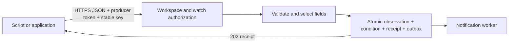

# Receive JSON from your software

**Pull:** Ding requests an HTTP endpoint, selects JSON fields, then evaluates the condition. **Push:** your software sends JSON to Ding, which performs the same projection and evaluation. Push is useful for private applications, job results, deployment events, heartbeats, and systems without a queryable status endpoint.



## Cloud setup

After this implementation is deployed, check `/v1/cloud/config` for `push.supported` and `push.admissionOpen`. Availability may be restricted to canary workspaces. The production URL is `https://cloud.ding.ing/v1/ingest/{watchId}`.

1. In the workspace's Workbench, create and review a `source.type: push` watch. [Example manifests](../../examples/cloud-push/watches.yaml) cover grouped CI failures, heartbeat monitoring, and batches of provider events. They record events without a notification destination; add a configured webhook, Slack, or Discord destination to send alerts.
2. Open **System → Services** as an owner or administrator. Choose **Send input to selected watches**, enter the existing watch IDs, and choose a 1–90 day expiry. Save the new secret in the producer's secret manager. Ding shows it once.
3. On the watch Overview, preview source JSON. This projects fields and predicts conditions from empty state; it does not accept input or send a notification. Preview fixtures are limited to 64 KiB; the ingest body contract is separately advertised (default 1 MiB, also bounded by the watch).
4. Send the request below. Save its receipt and retain its original body/key until acceptance is confirmed. Check the watch's input status, Events, and Deliveries separately.

```sh
curl --request POST 'https://cloud.ding.ing/v1/ingest/ci-results' \
  --header "Authorization: Bearer ${DING_PRODUCER_TOKEN}" \
  --header 'Content-Type: application/json' \
  --header 'Idempotency-Key: repo-123-run-456-attempt-1' \
  --data-binary '@ci-result.json'
```

`ci-result.json`:

```json
{"repo":"owner/api","workflow":"test","runId":"456","failed":true}
```

A subsequent successful run uses a **new** key and `failed:false`. It recovers only that repository/workflow group. For 18 repos, either grant a producer access to 18 named watches or use one watch with `groupBy: [repo, workflow]`. The bearer credential determines the workspace; JSON fields never authenticate or select a different workspace. Two customers may use identical watch names, field values, and request keys safely.

Use [Python](../../examples/cloud-push/send.py), [JavaScript](../../examples/cloud-push/send.mjs), or the [GitHub Actions job](../../examples/cloud-push/github-actions.yaml) for automation. The Python and JavaScript examples take an existing immutable body file and retry with the same key. The Actions job reports only success/failure, avoiding false recovery from canceled jobs. Native provider webhooks use [separate signed routes](cloud-webhooks.md).

## JSON contract

Send one UTF-8 JSON object with `Content-Type: application/json` (optional `charset=utf-8`). Compressed, form, and multi-document bodies are rejected. Hosted input rejects duplicate keys, excessive nesting/node count, nonfinite numbers, and integers outside ±9,007,199,254,740,991. Encode large identifiers as strings.

`source.fields` maps output aliases to dotted paths. Selected values must be scalars. Missing condition fields remain unknown; declared `groupBy` fields must be present and non-null. Unknown condition data does not automatically mean recovery. Only selected fields become retained evidence.

`source.itemsPath: events` selects a nonempty array within the root object, then applies `fields` to each item. The entire batch succeeds or fails together (default maximum 100 outputs). `itemsPath` works for HTTP JSON polling too. It cannot be combined with `jq`. Hosted projection uses fields/itemsPath; custom jq is available locally.

Inputs are evaluated in arrival order. Provider timestamps and workflow run IDs do not automatically reorder events. For out-of-order notifications, prefer an event watch (`new-event`) or send a serialized authoritative status summary. A heartbeat group begins monitoring after its first accepted input; an unseen group has no established heartbeat timer.

## Cloud receipts and retries

A 202 acknowledges durable monitoring input. Notification delivery is an independent, retryable process.

The receipt includes `acceptanceId`, `watchId`, `generation`, `revision`, `first`, `last`, `acceptedAt`, `expiresAt`, and `duplicate`. Receipt identity is `(workspace, watch lifetime, logical producer, idempotency key)`. The default retention horizon is 24 hours. Replays do not extend it.

- Exact bytes plus the same key return the original receipt without reevaluation. Different bytes return 409 `idempotency_conflict`.
- Rotation retains the logical producer and its receipts. Watch edits, pause, and evaluation resets preserve unexpired receipts. A new request follows the current watch state.
- Deleting/recreating a watch does not carry over authorization. Reauthorize explicitly for the new lifetime.
- Revoked credentials cannot read receipts. Two different producers have independent receipt namespaces; use `new-event` IDs if the condition also needs cross-producer deduplication.
- After expiry, reusing a key can create another observation. Keep retrying only within the advertised horizon. After an outage longer than the horizon, reconcile provider events before resubmitting.
- A timeout, broken connection, or 503 can leave acceptance uncertain. Retry **identical bytes and the original key**, with bounded backoff/jitter. Never manufacture a new key for each retry.

An idempotency key is 1–256 printable ASCII characters with no spaces. Use one authorization header and one idempotency header. The response supplies `X-Ding-Request-ID` for diagnostics. Tokens do not belong in query strings or payloads.

| Status | Producer action |
| --- | --- |
| 202 | Persist the receipt. `duplicate:true` is successful reconciliation. |
| 400 / 413 / 415 | Correct JSON, grouping, batch size, or media type. |
| 401 / 403 | Repair expired/revoked credentials or the selected watch grant. |
| 404 | Check the authorized target. |
| 409 | Inspect the stable code: changed/inactive watch or changed bytes for a used key. |
| 429 | Honor `Retry-After`; retry unchanged input. |
| 503 | Preserve the input; retry unchanged input when capacity/admission returns. |

## Rotation, access, and diagnostics

Producer credentials are workspace-owned. Removing their creator from the workspace does not revoke them. Owners/administrators can edit allowed watches, revoke the producer, revoke a specific key, or rotate with up to 24 hours of overlap (Console defaults to one hour). Ingest-only credentials cannot inspect evidence, manage watches, or sign into the Console/MCP.

If an issuance response is lost, use the producer list/key metadata to reconcile it. Rotate for a replacement secret, then revoke the uncertain old key. Key metadata reports coalesced last accepted use; it is diagnostic, not an exact audit counter.

The watch Overview separates last durable acceptance from condition state and notification delivery. Recent request diagnostics contain only time, status/code, and request ID, are bounded to 100 entries per workspace/24 hours, and clear on restart. The last acceptance survives restart and receipt pruning. `/v1/cloud/usage` reports durable accepted requests, bytes, and observations once per receipt; retries and rejects do not increment these totals.

## Local and shared instances

The route is still `POST /v1/ingest/{watchId}` at your daemon's configured origin, for example `http://127.0.0.1:PORT/v1/ingest/ci-results`. Find the actual origin in the local Console/connection information; there is no universal fixed port. Use the local ingest token, or a watch-scoped service credential on a shared server.

Local/shared receipt behavior remains generation-scoped with optional keys and the existing 24-hour horizon; it does not gain the hosted digest/lifetime contract above. Local jq remains supported. A remote provider cannot reach a laptop's loopback address without a separately configured secure public ingress.

Automatic cloud transfer currently supports HTTP watches. For push, export/create the watch at the destination, issue a destination-scoped producer key, change the producer URL, verify an accepted input, and deliberately stop the old producer path. Do not send the same workflow to both locations unless duplicate monitoring is intended.
